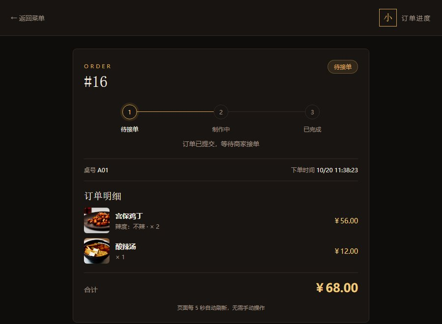
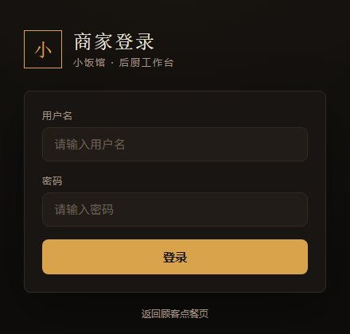

# 小饭馆 · 扫码点餐系统

一个用于**学习和作品展示**的全栈项目：顾客扫码浏览菜单、选辣度、下单并查看订单进度；商家登录后接单、完成出餐，并管理菜品上下架与售罄。

> 这是个人作品集项目，不是商用上线系统：没有支付、没有真实库存扣减、没有多门店。README 里不写虚构的用户量和营业额。

## 界面截图

顾客端菜单（扫码进入，手机和桌面都适配）：


| 订单进度 | 商家登录 |
| --- | --- |
|  |  |


## 目录结构

```
src/main/java/com/liuyuxian/order/
├── config/MerchantAuthFilter.java   商家接口鉴权过滤器
├── controller/                      菜单、订单、商家端、登录接口
└── OrderSystemApplication.java
src/main/resources/
├── static/                          顾客端 / 商家端 / 登录页（原生 HTML + CSS + JS）
└── application.properties           端口、数据库、演示账号配置
db/                                  建库脚本与两次表结构迁移
work/                                菜品图生成脚本（本地使用，不纳入版本库）
```


## 技术栈

- 后端：Java 17 + Spring Boot 3
- 构建工具：Maven
- 前端：原生 HTML / CSS / JavaScript
- 数据库：MySQL 8
- 版本管理：Git

## 开发进度

- [x] 第一步：项目骨架跑起来，浏览器能看到菜单页
- [x] 第二步：接入 MySQL，菜单从数据库读取
- [x] 第三步：下单功能（顾客点菜 → 订单保存到数据库 → 可查询）
- [x] 第四步：界面美化 + 本机打包运行（公网部署待服务器）
- [x] 第五步：商家登录与接口鉴权、菜品三态管理
- [x] 第六步：商家端新订单提醒、等待时长与移动端适配

## 如何运行

### 一键启动（推荐）

- 双击桌面「启动小饭馆」，或双击项目内 `启动小饭馆.cmd`
- 会自动检查 MySQL：未启动则启动；再检查 8080：已启动则直接打开入口页，不会重复启动
- 启动完成后自动打开 http://localhost:8080/hub.html

### 手动启动

1. 确保电脑已安装 JDK 17 和 Maven
2. 在项目根目录执行：`mvn spring-boot:run`
3. 浏览器打开：http://localhost:8080

Windows 用户也可以直接双击 `启动服务.cmd` 一键启动。

## 数据库

- 初始化脚本：`db/init.sql`，会创建 `order_system` 数据库、`menu` 表并插入 6 道菜。
- 执行方式：`mysql -u root < db/init.sql`，或使用本机 MySQL 客户端执行该文件。
- 本机 MySQL 通过桌面「启动MySQL」快捷方式启动。

## 配置项

`src/main/resources/application.properties` 支持用环境变量覆盖，仓库里给的是本地演示值：

| 配置 | 环境变量 | 默认值 |
| --- | --- | --- |
| 数据库账号 | `DB_USERNAME` | `root` |
| 数据库密码 | `DB_PASSWORD` | 空（本机 MySQL 默认） |
| 商家账号 | `MERCHANT_USERNAME` | `admin` |
| 商家口令 SHA-256 | `MERCHANT_PASSWORD_SHA256` | `admin123` 的哈希 |

默认账号口令写在公开仓库里，只适合本地演示；正式部署请用环境变量覆盖。


## 接口

- `GET /api/menu`：查询在售菜单
- `POST /api/orders`：提交订单

```json
{"tableNo":"A01","items":[{"menuId":1,"quantity":2},{"menuId":6,"quantity":1}]}
```

- `GET /api/orders/{id}`：查询订单详情
- `GET /api/orders`：订单列表（可选 `?status=PENDING|PREPARING|DONE`）
- `PATCH /api/orders/{id}/status`：更新订单状态

```json
{"status":"PREPARING"}
```

## 商家端

- 商家订单页：http://localhost:8080/merchant.html
- 支持待接单 / 制作中 / 已完成筛选
- 接单：PENDING → PREPARING；完成出餐：PREPARING → DONE
- 页面每 5 秒自动刷新一次

## 订单提醒与等待时长

- 每 5 秒轮询新订单；出现新订单时顶部横幅提示、播放提示音并闪烁页面标题
- 订单卡片显示「已等待 X 分钟」，超过 10 分钟高亮为红色
- 待接单/制作中按等待时间从久到近排序，已完成按下单时间倒序
- 右上角可开关提示音；浏览器要求先与页面交互一次才能播放声音

## 商家登录

- 登录页：http://localhost:8080/login.html
- 未登录访问 `/merchant.html` 会跳转登录，订单列表和状态更新接口也会被拦截
- 默认演示账号：`admin` / `admin123`（仅用于本地演示，上线前必须修改）
- 商家页右上角可退出登录

## 菜品管理

- 商家页面：http://localhost:8080/menu-admin.html（需登录）
- 三种状态：在售 `ON_SALE`、售罄 `SOLD_OUT`、下架 `OFF_SHELF`
- 顾客端：售罄菜品仍然显示但禁止下单；下架菜品直接隐藏
- 接口：`GET /api/merchant/menu`、`PATCH /api/merchant/menu/{id}/status`

## 顾客订单进度

- 下单成功后可点「查看订单进度」，或直接访问 `/order.html?id=订单号`
- 没有订单号时访问 `/order.html` 可手动输入查询
- 页面每 5 秒刷新，展示待接单 / 制作中 / 已完成的时间线

## 项目入口（自动更新）

- 入口页：http://localhost:8080/hub.html
- 每 5 秒自动读取当前局域网 IP 和 cloudflared 公网地址，并动态生成二维码
- 双二维码区域：输入桌号，同网 / 不同网各一张，跟随当前地址自动更新，可分别下载
- 局域网/公网卡片只显示地址，不再重复放二维码图；页面只保留一套二维码生成
- 换 Wi-Fi 后不需要手动改地址；公网隧道重启后也会自动更新
- 桌面快捷方式：`小饭馆项目入口.url`
- 旧 `/mobile.html` 已改为自动跳转到 `/hub.html`

## 打包运行

```powershell
mvn clean package
java -jar target/order-system-0.0.1-SNAPSHOT.jar
```

也可以直接双击 `启动服务.cmd`，脚本会用 JAR 启动（不需要 Maven）。

## 已知限制

- 没有做幂等，快速重复点击可能产生重复订单；真实系统需要请求 ID + 唯一索引。
- 没有支付、退款、真实库存扣减、多门店、操作日志。
- 商家端用 5 秒轮询，不是 WebSocket；实时性够用但不适合高并发。
- 默认演示口令是公开的，正式使用必须通过环境变量覆盖。
- 公网演示用的是临时隧道，地址不固定，所以不写进 README。

## 许可

MIT，见 [LICENSE](LICENSE)。

